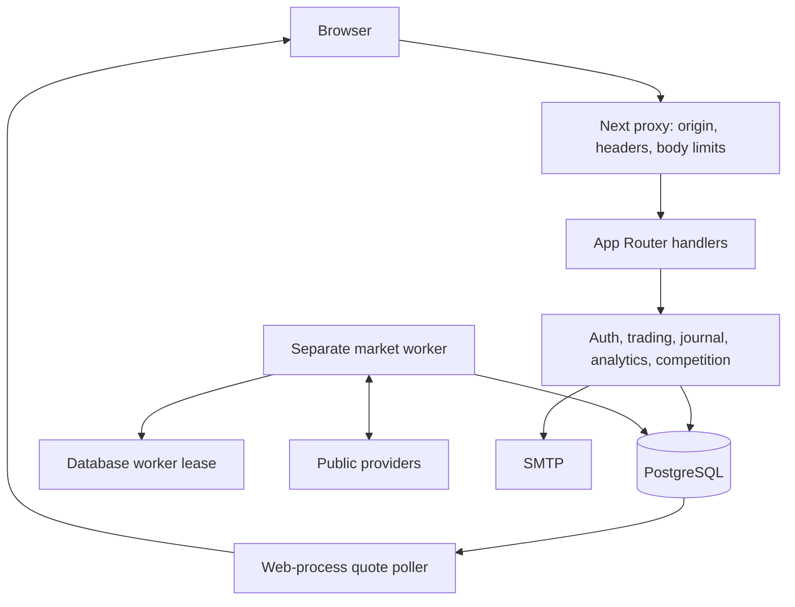

# Architecture

[Back to README](../README.md)

ALPHA TERMINAL is a server-authoritative paper-trading application. The browser renders context and submits intent. PostgreSQL-backed services validate ownership, market freshness, instrument rules, account state, and balances before changing financial state.

## Runtime topology

The web and worker are separate Node.js processes. Their integration boundary is PostgreSQL, not an in-memory worker-to-web event bus. Each web process polls shared quote rows for its local SSE subscribers.

## Request and order lifecycle

1. The proxy validates unsafe browser origins and bounds request bodies, including chunked requests.
2. The handler authenticates the opaque session, applies relevant rate limits, and validates a strict Zod schema.
3. Services resolve the account from **user identity plus scope**, never from a client-supplied balance.
4. Trading reads the instrument/quote and acquires the account lock through `withAccount`.
5. Shared `validateOrder` logic checks market status, data mode, quote freshness, challenge eligibility, tick/quantity rules, leverage, inventory, and cash.
6. Decimal arithmetic computes reservations, fees, settlement, and ledger movements.
7. One transaction persists the order, account/position changes, executions, ledger entries, lifecycle events, and applicable notifications.
8. The client receives a normalized response and links to the order audit.

`previewOrder` shares validation with `createOrder` but does not write orders or reservations. It reports the current estimate; submission must revalidate because prices and balances can change.

### Idempotency and concurrency

- `(accountId, clientOrderId)` identifies a retryable order request.
- A normalized request fingerprint rejects reuse of the ID with different order details.
- A second idempotency lookup inside the account lock handles concurrent submissions.
- Account locks and bounded transaction retries coordinate web submissions, worker fills, and cancellation.
- User-row locks serialize concurrent watchlist defaults and preference merges.
- Worker-managed transactions fence writes against lease ownership and expiry.

## Financial records

| Record | Responsibility |
| --- | --- |
| `TradingAccount` | Initial capital, current cash/reservations, cumulative realized P&L, fees, funding, and scope. |
| `Order` | Intent, execution parameters, lifecycle status, reservations, and idempotency identity. |
| `Execution` | Recorded quantity, execution price, fees, realized P&L, and timestamp. |
| `Position` | Current quantity, cost basis, margin, leverage, and derivative state. |
| `LedgerTransaction` / `LedgerEntry` | Atomic cash, asset, fee, margin, and P&L movements. |
| `OrderEvent` | Append-only acceptance, trigger, fill, release, bracket, resize, and liquidation events. |
| `PortfolioSnapshot` | Persisted account valuations for history and analytics. |

Database constraints protect nonnegative cash and valid account origins. Triggers protect immutable financial identities/finalized records; a separate trigger rejects updates/deletes to order events. Reconciliation compares derived cash, inventory, margin, and reservations with materialized state. It reports drift instead of silently rewriting history.

## Account scopes and user workspace

`main` identifies the normal account. A joined challenge uses its challenge ID as scope. The URL is the source of truth for selected scope; scoped links carry it through navigation. Switching scope remounts account-specific content and clears stale order context. Server queries independently enforce ownership and challenge rules.

Watchlists and chart/notification preferences belong to a user. Journal entries belong to a user **and account**, with optional owned order/instrument links. Closed challenge-account notes remain editable independently of trading eligibility.

## Market data and streams

- Coinbase is the default registry provider; Binance REST is selectable for a fresh registry.
- Existing instruments are authoritative. Provider configuration does not overwrite persisted mappings.
- Quote persistence compares source timestamps atomically so delayed writers cannot replace newer data.
- Execution freshness requires LIVE mode and valid source/receipt timestamps within the configured age.
- Cached-first market rendering improves page loading; a cached display does not authorize a fill.
- Candles are normalized, sorted, and deduplicated before charting. SMA requires a full window; EMA starts from an SMA seed.
- SSE uses a web-process subscriber set, reads shared PostgreSQL quotes every approximately two seconds, and bounds connections/symbol counts. Slow readers drop updates rather than accumulate an unbounded queue.
- Streams reconnect after one minute to revalidate sessions. A stream accepts at most 30 symbols; a web process allows at most 500 subscribers and five per user.

Multiple web replicas can read the same database. Polling load and per-process connection limits grow with replicas. Redis/Upstash fanout is a potential future design, not an implemented switch.

## Worker lifecycle

The worker competes for a database lease, renews ownership, and records successful cycles. Only the current owner performs scheduled work. Fenced transactions reject a former owner that resumes after expiry or takeover. Lease loss ends leadership cleanly.

The worker ingests quotes, processes pending orders, applies derivative funding/liquidation maintenance, writes portfolio/leaderboard snapshots, finalizes challenges, evaluates fresh price alerts, and cleans up expired identity/rate-limit data. Preferences can suppress a notification without suppressing its underlying execution or audit event.

`/api/health` checks the application database connection. `/api/ready` additionally requires a valid lease and a recent successful worker cycle. Readiness is not a guarantee that every upstream market symbol has a fresh quote.

## Analytics and exports

Analytics use a RepeatableRead transaction. Period baselines use a preceding snapshot when available; unavailable baselines remain null. Challenge history is capped at its deadline. Metrics scan all relevant snapshots in pages of 1,000 and aggregate all matching executions; display limits do not truncate the metric calculation.

Closing-fill outcome statistics are gross of fees/funding, and partial closes count separately. Exposure charts display at most 120 recent points. Ordinary portfolio history displays at most 500 snapshots.

CSV exports authorize the account, capture an upper timestamp boundary, and paginate in batches of 500. Values are quoted and spreadsheet formula prefixes neutralized. Journal entries may still be edited during an export; this is not a long-lived transactional database backup.

## Verification boundaries

Unit/integration and browser wrappers create unique `alpha_test_*` schemas and never truncate `public`. E2E builds under one origin and runs a copied standalone artifact under another to regress runtime-origin handling. Recovery tests use local SMTP; worker tests exercise competing processes and takeover.

The screenshot tool uses a separate `alpha_screenshots_*` schema with synthetic market/history fixtures. It captures the actual application without editing its rendered values. See the [development guide](development.md) and [operations runbook](operations.md).
