# Product tour

[Back to README](../README.md)

All images below show the v0.2.0 interface running from a production standalone build. Click an image to inspect it at full resolution.

## Trading terminal

Select a named watchlist, inspect the chart, and prepare a spot order. The preview is calculated on the server and reports notional, fees, reservations, remaining cash, and maximum quantity. Submission rechecks the current account and quote.

[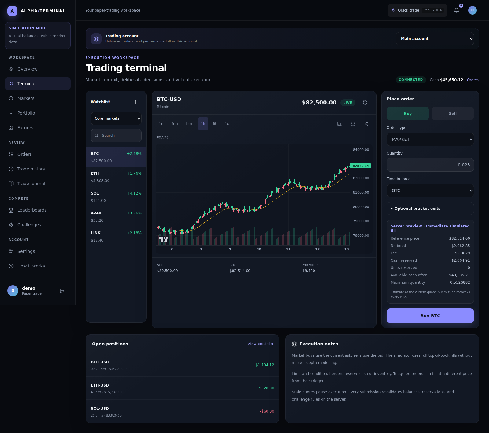](screenshots/terminal.png)

## Chart preferences

Candles, line, and area; six timeframes from one minute to one day; configurable SMA/EMA periods; volume and crosshair toggles. Defaults are persisted from the terminal settings dialog.

[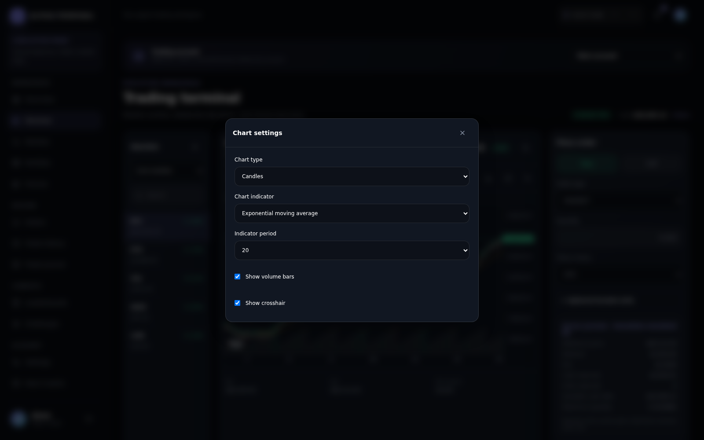](screenshots/chart-settings.png)

## Dashboard

Current account capital, open positions, recent orders, market movers, and a history chart sourced from account snapshots. The scope selector switches between owned main/challenge accounts.

[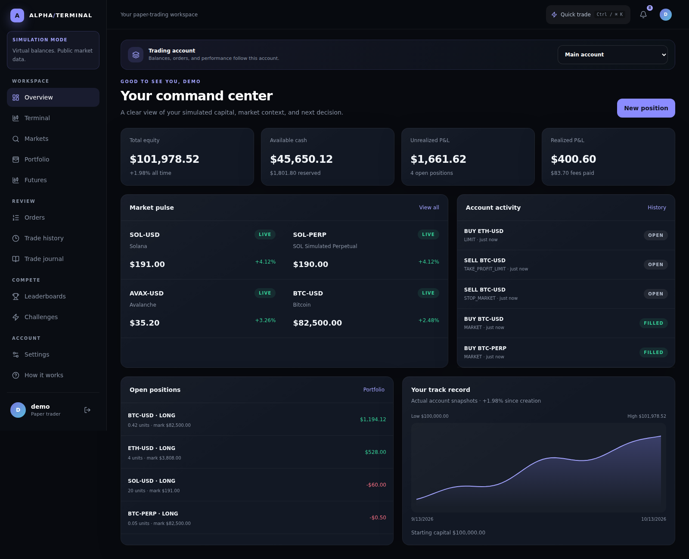](screenshots/dashboard.png)

## Markets and watchlists

Manage named watchlists and their ordering. Stars in Markets use the default list; spot and derivative links open the appropriate workspace while retaining the selected account.

[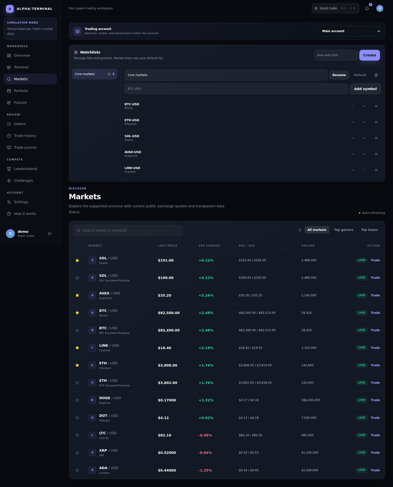](screenshots/markets.png)

## Portfolio analytics

Review returns, drawdown, gross closing-fill outcomes, fees, funding, and spot exposure. Range controls support 1D, 7D, 30D, and All. Current holdings export to CSV; analytics export to JSON; complete snapshot history has a streaming CSV export.

[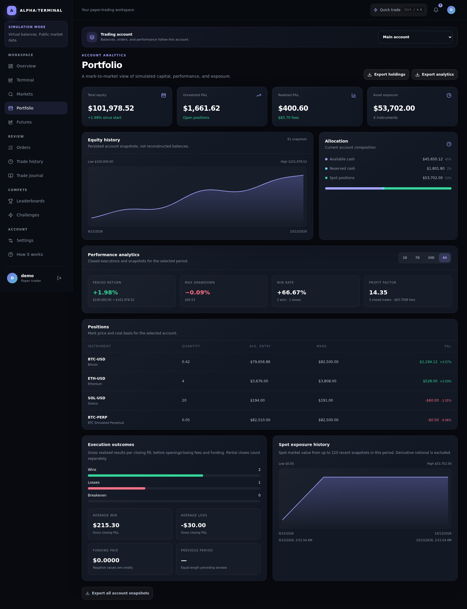](screenshots/portfolio.png)

## Trade journal

Keep searchable notes with titles, tags, emotion, and outcome. Link a note from order details to retain context. Notes in ended challenge accounts remain accessible and editable when owned by the user.

[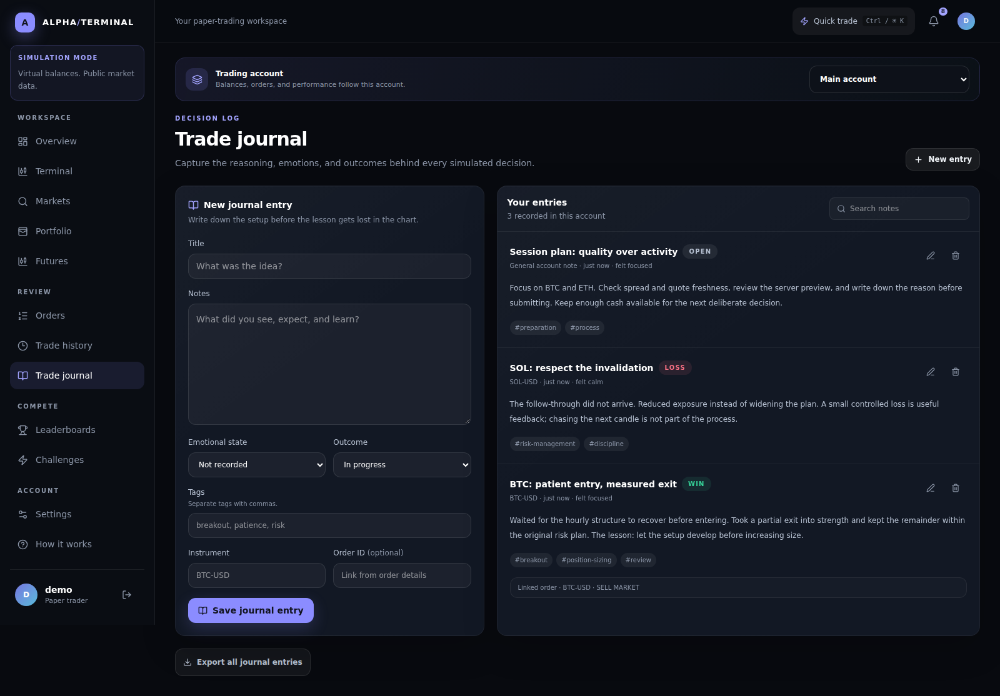](screenshots/journal.png)

## Execution audit

Inspect fills, recorded fees, lifecycle events, reservation state, and linked bracket orders. The timeline is append-only. Older orders may have no events because pre-v0.2.0 activity is not backfilled.

[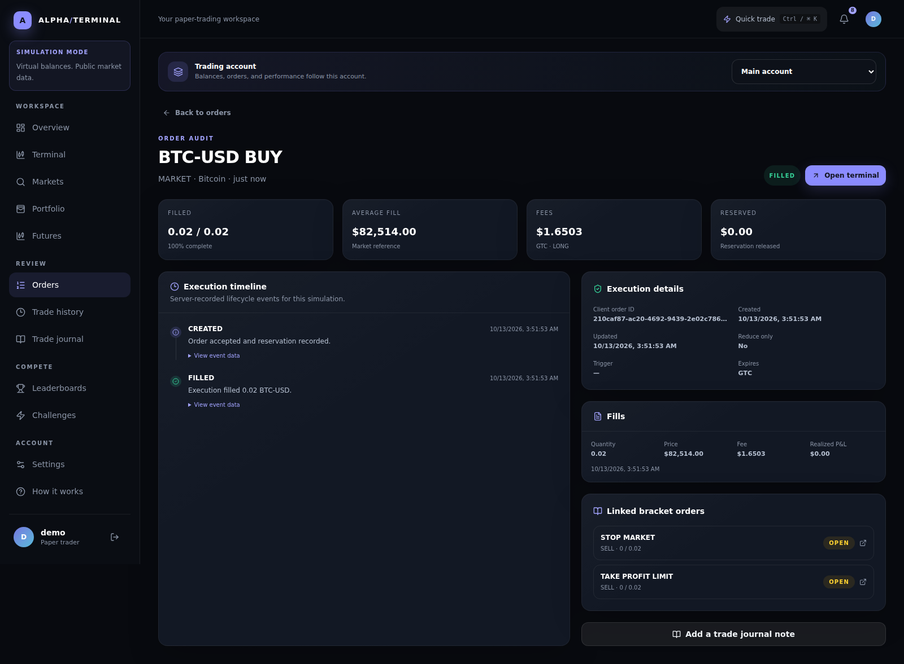](screenshots/order-detail.png)

## Synthetic perpetuals

Practice long/short isolated positions, choose leverage within the instrument limit, preview entry/close, and inspect margin, funding, and liquidation levels. These are simulated contracts with fixed model assumptions.

[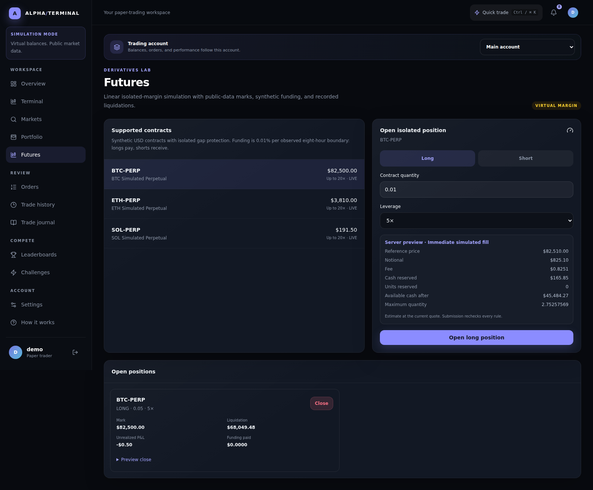](screenshots/futures.png)

## Challenges

Join a timed account with its own starting balance, eligible markets, and leverage rules. The account selector follows your joined challenge through navigation.

[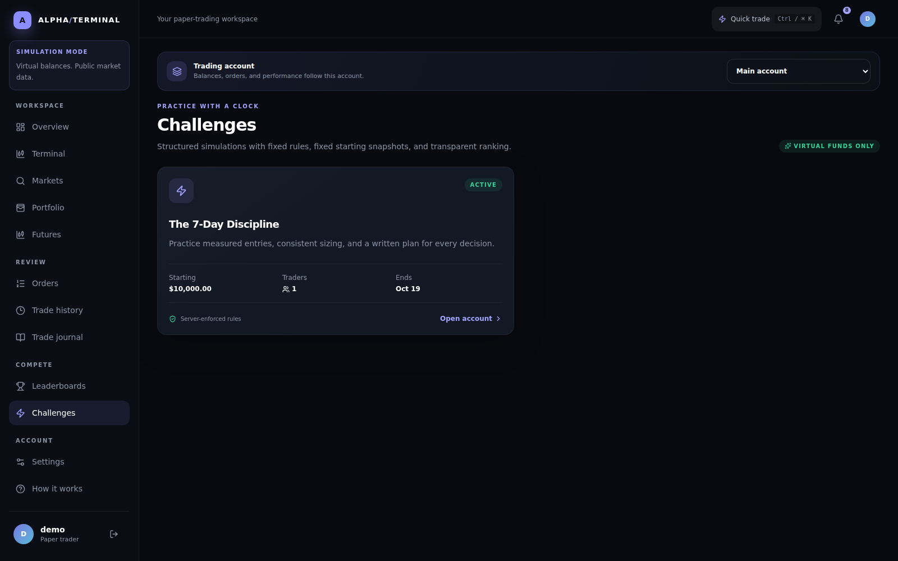](screenshots/challenges.png)

## Account settings

Manage profile visibility, sessions, password changes, price alerts, and notification categories. Recovery and verification delivery use configured SMTP.

[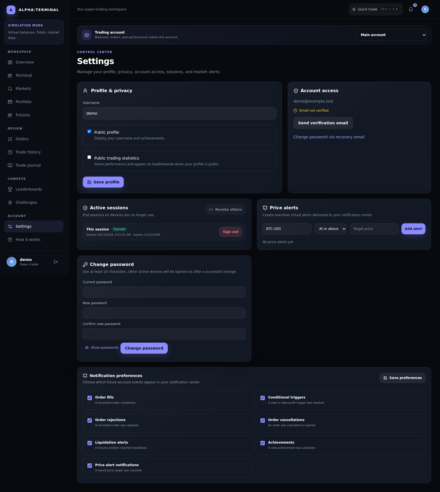](screenshots/settings.png)

## Quick commands

Open with Ctrl/⌘K or the Quick trade button. Search pages and instruments, use arrow keys to select, Enter to navigate, and Escape to close. Focus returns to the opener.

[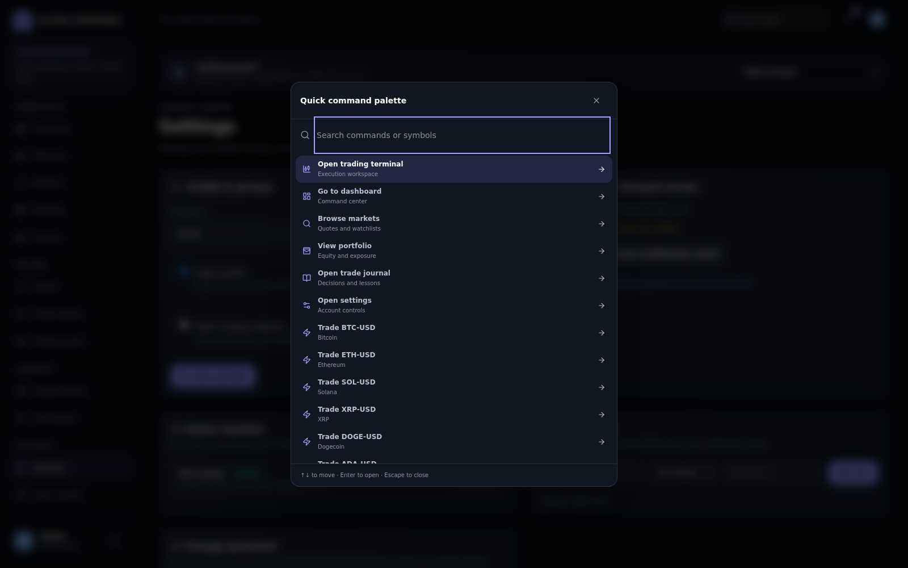](screenshots/command-palette.png)

## Mobile workspace

Responsive layouts, safe-area bottom navigation, scrollable charts, and a focus-managed navigation drawer support smaller screens. The gallery uses a 390 × 844 viewport; browser regression coverage also exercises 320px widths.

| Dashboard | Terminal | Journal |
| :---: | :---: | :---: |
| 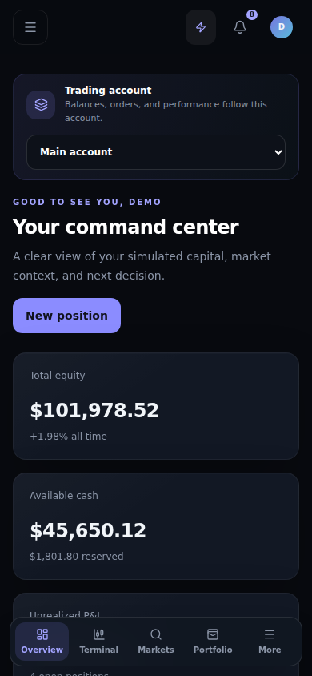 | 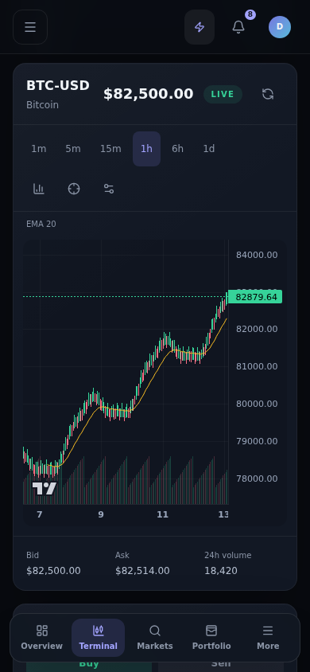 | 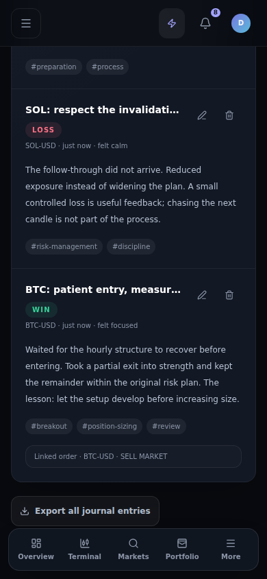 |

## Landing page

[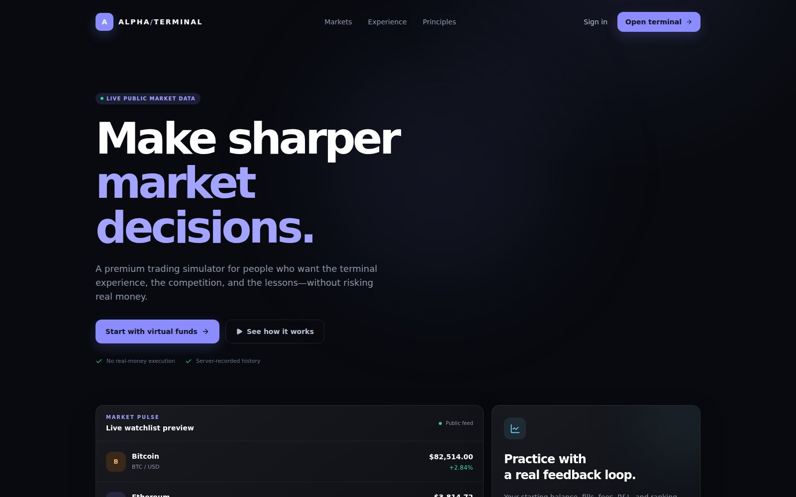](screenshots/landing.png)

## Reproduce the gallery

With dependencies, a local PostgreSQL database, and Chromium installed:

```bash
npx playwright install --with-deps chromium
npm run screenshots
```

The script creates a unique `alpha_screenshots_*` schema, applies migrations, builds a production artifact, and starts a copied server on `127.0.0.1:3200`. It creates a disposable account with a random password, submits simulated orders through the API, adds journal/watchlist data, and seeds a clearly synthetic 30-day snapshot series. Public providers cannot overwrite the screenshot fixtures.

Desktop views use 1600 × 1000 with full-page captures where appropriate. Mobile captures use 390 × 844. The script waits for actual content and previews, checks overflow and browser errors, captures lossless PNGs, then removes only its own schema and temporary runtime. The checked-in gallery contains 15 images.

**Provenance:** prices, volumes, changes, trades, and history are demonstration fixtures. The screenshot-only quotes are marked eligible inside the disposable schema so real validation/settlement paths can be exercised. These images do not represent a live account or investment performance. The normal database, environment file, and personal accounts are not modified.

## Current boundaries

- Chart defaults are managed in the terminal, not a separate chart-preference page.
- The journal provides notes/tags, not a dedicated strategy/setup field.
- The order-list CSV exports loaded rows; complete streaming exports cover executions, snapshots, and journal entries.
- Analytics win/loss counts are per closing fill and exclude fees/funding from the outcome classification.
- The application supplies a practice workflow, not brokerage execution or exchange-depth simulation.
